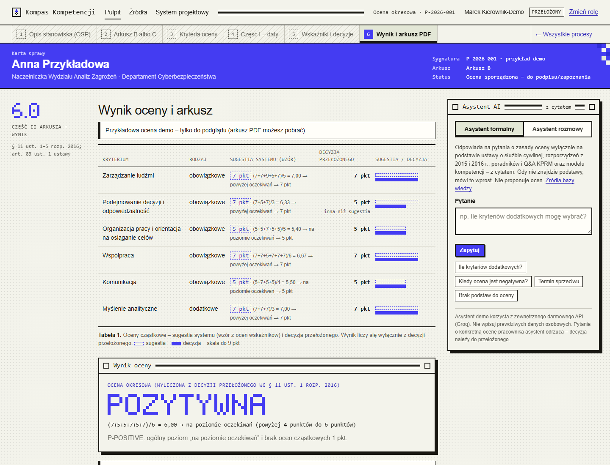

# Kompas Kompetencji: ocena w służbie cywilnej krok po kroku, z decyzją zawsze po stronie przełożonego

Kompas Kompetencji prowadzi przełożonego w służbie cywilnej przez ocenę okresową i pierwszą ocenę: od opisu stanowiska (OSP) przez kryteria i wskaźniki behawioralne do arkusza PDF według wzoru z rozporządzenia. Przełożony opisuje własnymi słowami, co zaobserwował u pracownika, a asystent oceny zachowań proponuje poziom przy każdym wskaźniku z cytatem opisu z modelu kompetencji i fragmentem opisu przełożonego jako dowodem. Przełożony przyjmuje albo zmienia propozycje, sugerowany poziom kryterium liczy jawna reguła, decyzję podejmuje przełożony. Asystent AI prowadzi też z przełożonym rozmowę o przepisach: można pytać potocznie i dopytywać, każde zdanie odpowiedzi ma cytat jednostki redakcyjnej, a bez podstawy asystent odmawia. Administrator może dopisać do bazy wiedzy dokumenty urzędu. Rozwiązanie zadania KOMPAS KOMPETENCJI (Biuro Dyrektora Generalnego, Ministerstwo Cyfryzacji) na HackNation 2026.

**Demo (2 min):** {{DEMO_URL}} · **Prezentacja:** {{PREZENTACJA_URL}} · **Działająca wersja:** {{RENDER_URL}} · **Repozytorium:** https://github.com/jakubkalinski0/kompas-kompetencji



Logowanie jednym kliknięciem: przełożony **Marek Kierownik-Demo** albo HR **Zofia Kadrowa-Demo** (osoby fikcyjne). Aplikacja jest na komputer i tablet; na smartfonach wykrywa urządzenie mobilne i pokazuje komunikat, że telefony nie są obsługiwane (pkt 2 treści zadania). Pierwsze otwarcie po przerwie trwa do minuty.

## Dla kogo i jaki problem rozwiązuje

- **Użytkownik:** przełożony, który ocenia członków korpusu służby cywilnej (ocena okresowa co 24 miesiące, pierwsza ocena w służbie przygotowawczej), oraz kadry, które pilnują terminów.
- **Problem dziś:** ocena opiera się na ustawie, dwóch rozporządzeniach, trzech wzorach arkuszy i modelu 14 kompetencji z 49 wskaźnikami w 5 poziomach. Przełożony robi ją rzadko, więc łatwo o błąd formalny: czwarte kryterium dodatkowe, ocenę negatywną bez uzasadnienia, przegapiony termin.
- **Co zmienia Kompas:** każdy krok ma podstawę prawną, a reguły z rozporządzeń są sprawdzane przy zapisie. Przy każdym wskaźniku przełożony widzi opisy zachowań z modelu. Na 36 pytaniach testowych asystent odmówił na wszystkie 7 spoza zakresu i ani razu nie zacytował źródła spoza fragmentów, które dostał.

## Ścieżka dla jurora (5 minut)

1. Zaloguj się jako Marek Kierownik-Demo i rozpocznij ocenę okresową Ewy Fikcyjnej.
2. OSP: wybierz przykładowy opis stanowiska („Użyj tego OSP”) albo wczytaj własny `.docx`. Kompas proponuje arkusz C z podstawą prawną; potwierdzasz go ty.
3. Kryteria: zaznacz cztery dodatkowe, żeby zobaczyć blokadę z § 5 ust. 2; „Zaproponuj kryteria z zadań (AI)” podaje kandydatów z dosłownym cytatem zadania z OSP.
4. Karty wskaźników (kryterium „Rzetelność”): w oknie „Asystent oceny zachowań” opisz, co zaobserwowałeś, np. „Raport kwartalny oddała trzy dni przed terminem. Sama zauważyła błąd w danych z innego wydziału i zaproponowała dodatkową kontrolę, którą wdrożyliśmy w zespole. Raz przy projekcie ustawy zgłosiła opóźnienie dopiero po terminie.” Asystent proponuje poziom przy każdym wskaźniku z cytatem opisu z modelu i fragmentem Twojego opisu. „Zaznacz wszystkie propozycje” zaznacza je z dopiskiem „propozycja AI” – każdą możesz zmienić. Kompas poziomu przelicza sugestię na żywo i pokazuje wzór; „Zapisz decyzję” zapisuje Twój poziom w śladzie decyzji.
5. Podsumowanie: wynik według § 11 rozporządzenia z 2016 r. i „Pobierz arkusz PDF”.
6. Asystent AI (menu u góry albo kafelek na pulpicie): zapytaj własnymi słowami „Pracownik nie zgadza się z oceną okresową – co dalej?”, a potem dopytaj „A ile dyrektor ma czasu na rozpatrzenie?”. Obie odpowiedzi cytują art. 83 ustawy, a numer w nawiasie rozwija treść przepisu. Pytanie „Ile wynosi płaca minimalna w 2026 roku?” kończy się odmową. Ten sam asystent jest w panelu z prawej przy każdym kroku oceny i pamięta rozmowę między krokami.
7. Wyloguj się i wejdź jako Zofia Kadrowa-Demo: panel HR z terminami, flagami i „Wyślij przypomnienie”, bez ocen wskaźników i notatek z rozmowy. W „Baza wiedzy” wgraj przykładowe fikcyjne zarządzenie DG (link przy formularzu), wróć jako przełożony i zapytaj „Do kiedy mam przekazać podpisany arkusz do kadr?”: odpowiedź cytuje § 3 zarządzenia.

## Jak spełniamy kryteria

Wagi z pkt 8 treści zadania.

| Kryterium | Waga | Co zrobiliśmy | Gdzie to zobaczyć |
|---|---|---|---|
| Zgodność merytoryczna i realizacja założeń | 25% | Ocena okresowa (arkusz B albo C) i pierwsza ocena na jednym silniku. Arkusz z OSP z podstawą prawną (§ 3 rozp. 2016), najwyżej 3 kryteria dodatkowe (§ 5 ust. 2), wynik według § 11, warunki pierwszej oceny (§ 10 ust. 1 rozp. 2015), Część III tylko dla urzędnika na wniosek, terminy ze świętami | ścieżka dla jurora, kroki 1–5; `app/workflow.py`, `.claude/skills/kompas-model-i-silnik-oceny/` |
| Użyteczność i doświadczenie użytkownika | 25% | Kroki z podstawą prawną, karty wskaźników z opisami zachowań i „brak podstaw do oceny”, notatki S-D-R, Kompas poziomu na żywo, panel HR z flagami terminów, logowanie jednym kliknięciem. Stałe znaczenia: linia przerywana to sugestia systemu, ciągła to decyzja przełożonego, czerwień to skutek prawny | `/design` w aplikacji, [DESIGN.md](DESIGN.md) |
| Jakość i użyteczność AI | 20% | Asystent oceny zachowań: opis przełożonego → propozycja poziomu przy każdym wskaźniku z cytatem opisu z modelu MC i dosłownym fragmentem opisu (walidator odrzuca propozycję bez dosłownego fragmentu i fragmenty-polecenia „daj 5”), nazwiska maskowane, propozycje zaznacza przełożony, a w danych zostaje, co zaproponowało AI i co wybrał przełożony. Asystent formalny jako rozmowa: pytania potoczne (słownik potoczne → język przepisów), pytania uzupełniające z kontekstem dwóch poprzednich tur, FAQ, BM25, odpowiedź z klikalnym cytatem sprawdzanym z kontekstem albo odmowa. Wgrywanie dokumentów urzędu do bazy wiedzy (PDF, DOCX, TXT) z maskowaniem danych osobowych. Asystent rozmowy: pytania, informacja zwrotna S-D-R, szkic uzasadnienia, wnioski rozwojowe, z podglądem po zamaskowaniu danych. Kryteria z zadań OSP tylko z dosłownym cytatem. Poziomu kryterium nie liczy model | `/asystent` i `/zrodla` w aplikacji, sekcja „Wyniki”, [docs/ewaluacja.md](docs/ewaluacja.md) |
| Innowacyjność i jakość rozwiązania | 20% | Sugestia oddzielona od decyzji w danych i w śladzie decyzji, deterministyczny silnik z jawnym wzorem, walidator odrzucający propozycje AI bez cytatu, test wstrzyknięcia poleceń w treść OSP i we wgrany dokument, 28 testów aplikacji i 218 testów modułów | `tests/`, `.claude/skills/*/tests/` |
| Potencjał wdrożeniowy | 10% | Darmowy stos (FastAPI, SQLite, reportlab), tylko licencje permisywne, wymienny model (darmowe API Groq albo lokalna Ollama, przy której dane nie opuszczają urzędu), API `/api/v1` z rolami, kontrakt eksportu do EZD RP i importu z systemu kadrowego | `/docs` w aplikacji, [docs/wdrozenie.md](docs/wdrozenie.md) |

## Wyniki

Asystent formalny na zbiorze `eval_holdout.json`, rozłącznym z FAQ: 29 pytań o zasady oceny i 7 spoza zakresu, baza wiedzy 366 jednostek. Wyszukiwanie jak w działającej wersji (BM25), model lokalny `llama3.1:8b`:

| Metryka | Wynik |
|---|---|
| poprawne odmowy na pytania spoza zakresu | 7/7 |
| odpowiedzi na pytania o zasady, z cytatem sprawdzonym z kontekstem | 22/29 |
| odpowiedź cytuje oczekiwaną jednostkę redakcyjną | 19/22 |
| cytaty spoza kontekstu | 0/36 |
| pokrycie punktów kluczowych (heurystyka słów) | 0,82 |
| czas p50 / p95 (laptop z GPU 6 GB) | 16 s / 43 s |

Punkt odniesienia: hybryda BM25 z embeddingami miała hit@5 0,93 i komplet oczekiwanych jednostek w top-5 w 79% pytań, sam BM25 0,97 i 90%. Siedem odmów na pytania w zakresie to odpowiedzi małego modelu bez poprawnego źródła, a aplikacja nie pokazuje odpowiedzi bez źródła. Działająca wersja używa `openai/gpt-oss-120b` (Groq); pełnego zbioru na nim nie mierzyliśmy z powodu dziennego limitu tokenów. Szczegóły: [docs/ewaluacja.md](docs/ewaluacja.md).

## Uruchomienie

Do oceny wystarczy działająca wersja. Lokalnie aplikacja potrzebuje danych zbudowanych z materiałów MC, których publiczne repozytorium nie zawiera, bo MC udostępnił je tylko uczestnikom. Z materiałami w `materialy/`:

```bash
pip install -r requirements-dev.txt
python .claude/skills/kompas-dane-i-zrodla/scripts/build_data.py --input materialy --output deploy/processed  # wymaga pdftotext
uvicorn app.main:app --reload       # http://127.0.0.1:8000
python -m pytest tests -q           # test dymny: TestClient, atrapa modelu, bez sieci
```

Testy modułów działają bez danych MC: `python -m pytest .claude/skills/kompas-model-i-silnik-oceny/tests -q` (tak samo pozostałe `kompas-*`). Bez klucza API asystent działa na lokalnej Ollamie (`LLM_PROVIDER=ollama`); klucz Groq trafia tylko do `.env` albo do zmiennej `LLM_API_KEY` na serwerze.

## Architektura

```
przeglądarka (Jinja2 + htmx) ── FastAPI (app/) ── SQLite: procesy i ślad decyzji
                                   │
     moduły .claude/skills/kompas-*: silnik oceny · analiza OSP · PDF i terminy · role · asystent
                                   │
           maskowanie danych osobowych ── model: Groq (darmowe API) albo Ollama (lokalnie)
```

Logika oceny jest w modułach w czystym Pythonie, a aplikacja łączy je w ścieżkę ([app/skills.py](app/skills.py)). Model językowy nie liczy poziomu kryterium ani wyniku: w asystencie formalnym dostaje pytanie i 5 jednostek z bazy wiedzy, a filtr odrzuca odpowiedź z cytatem spoza kontekstu i wycina propozycje punktów; w asystencie oceny zachowań proponuje poziomy wskaźników, które przechodzą przez walidator dowodu i trafiają do formularza dopiero po kliknięciu przełożonego. HR dostaje dane z białej listy pól.

## Dane

- Materiały MC (model kompetencji, trzy OSP, wzory arkuszy, rozporządzenia, poradniki KPRM) przetwarza deterministyczny `build_data.py`; wynik nie trafia do publicznego repozytorium.
- Źródła publiczne pobrane przez zespół: ustawa o służbie cywilnej (ELI Sejmu) i pytania o oceny z serwisu służby cywilnej na gov.pl. Do tego 29 pytań i odpowiedzi napisanych przez zespół.
- Dokumenty urzędu: administrator wgrywa je w aplikacji; do demo jest fikcyjne zarządzenie DG (`app/static/demo/`, generuje je `scripts/make_demo_source.py`). Przed zapisem Kompas maskuje w nich PESEL, e-maile, telefony, adresy i imiona z nazwiskami, a oryginału pliku nie przechowuje.
- Dane osobowe: tylko fikcyjne persony. Przed wysłaniem do modelu nazwiska osób z procesu, PESEL, e-maile, telefony i adresy zamieniają się w znaczniki (Pracownik A, [TELEFON]), a przełożony widzi podgląd tego, co wychodzi.

## Ograniczenia

- Przeliczenie pięciu poziomów modelu na skalę 3/5/7 pkt pierwszej oceny przyjęliśmy sami; aplikacja oznacza je jako do potwierdzenia z MC.
- Przypomnienia e-mail i eksport do EZD RP to makiety (wpis w logu, pakiet z sumą SHA-256), bez połączenia z prawdziwymi systemami.
- Maskowanie danych osobowych to heurystyka: nie rozpozna nazwiska bez imienia osoby spoza procesu ani opisu, który pośrednio wskazuje osobę.
- Dokumenty urzędu wgrane w demo są widoczne tylko w sesji, w której je dodano, i znikają po restarcie instancji. Skanów bez warstwy tekstowej Kompas nie odczyta (brak OCR). W wersji produkcyjnej baza wiedzy wymaga wersjonowania dokumentów i zatwierdzania zmian przez administratora.
- Propozycje poziomów wskaźników od asystenta oceny zachowań to sugestie modelu językowego. Nie mierzyliśmy ich zgodności z ocenami doświadczonych przełożonych – to pierwsza rzecz do sprawdzenia w pilotażu z MC.
- Pytania potoczne rozumiemy przez krótki słownik potocznych sformułowań (np. „nie zgadza się” → sprzeciw) i przez model. Pytania w zupełnie innym języku niż przepisy mogą nadal kończyć się odmową.
- Darmowy hosting usypia po 15 minutach, a procesy jurorów znikają po restarcie. Limit Groq pozwala na 4 pytania do modelu na minutę; FAQ i odmowy regułą działają bez modelu.
- Nie testowaliśmy z przełożonymi ani kadrami MC.

## Wdrożenie i koszty

Działająca wersja to darmowa instancja Render z jednym plikiem [render.yaml](render.yaml). W urzędzie wystarczy serwer z Pythonem 3.13 i lokalna Ollama zamiast Groq, żeby dane nie wychodziły poza sieć. Koszt modelu w prototypie: 0 zł. Eksport do EZD RP i import z systemu kadrowego opisuje kontrakt API (`/api/v1/integrations/contract`). Następny krok: pilotaż w MC na kilku ocenach. Szczegóły: [docs/wdrozenie.md](docs/wdrozenie.md).

## Ujawnienie

- **Co powstało podczas hackathonu:** aplikacja (`app/`), testy aplikacji, wdrożenie, system projektowy, pomiary asystenta i dokumentacja.
- **Materiały przygotowane przed wydarzeniem:** skille `.claude/skills/hn-*` (wspólny pakiet przygotowawczy zespołu: zasady zgłoszenia i kontrola repozytorium). Moduły `.claude/skills/kompas-*` (silnik oceny, analiza OSP, dokumenty i terminy, asystent AI, dane, ewaluacja) pochodzą z pakietu `prep/kompas_kompetencji` w repozytorium przygotowawczym zespołu {{POTWIERDZIĆ: przed wydarzeniem czy w trakcie}}.
- **Narzędzia AI użyte przy tworzeniu:** Claude Code (kod, testy, dokumentacja). W działaniu aplikacji: `openai/gpt-oss-120b` przez darmowe API Groq; w pomiarach lokalnie `llama3.1:8b` i `nomic-embed-text` w Ollamie.
- **Kod i zasoby stron trzecich:** zależności z licencjami w [LICENSES-THIRD-PARTY.md](LICENSES-THIRD-PARTY.md) (MIT, BSD, Apache-2.0, PSF); htmx 2.0.4 (0BSD) w `app/static/`; fonty DejaVu w arkuszach PDF.

## Zespół

{{ZESPÓŁ: imię i nazwisko – rola}}

## Licencja

{{LICENCJA_KODU}}. Prawa do zwycięskiego rozwiązania, także do kodu, przechodzą na MC (regulamin § 4), dlatego zależności mają wyłącznie licencje permisywne: [LICENSES-THIRD-PARTY.md](LICENSES-THIRD-PARTY.md).
